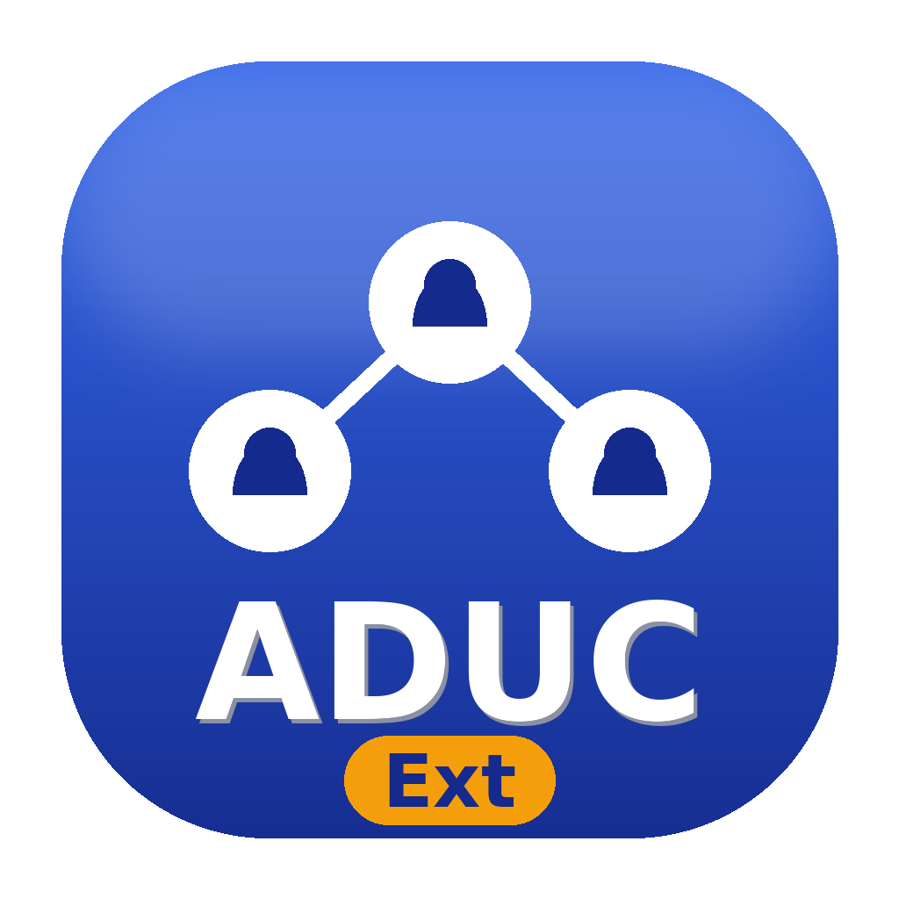

<div align="center">



# ADUC-Extended

GUI application for managing Active Directory accounts — Windows (PowerShell + WPF)
and macOS (Python + Tkinter).


**English** · [Русская версия](README_ru.md)

💛 **На развитие проекта:** https://dalink.to/rderensky

</div>

---

A single bilingual application: the interface language (**English / Русский**)
switches on the fly — in the login window and in the main window. On startup the
app prompts for credentials and performs all operations under the specified account.

## Features

- Search and view user properties (including password details: last set date,
  change required, bad password attempts).
- Computer objects (Users / Computers mode toggle): search, properties, rename,
  move between OUs, edit description, enable/disable, delete.
- Navigation of the organizational unit (OU) tree.
- Account creation: name, login, UPN, e-mail, description, password, OU selection
  via the tree, expiration date, group selection; duplicate-login check.
- Enable, disable, and unlock accounts.
- Password reset.
- Group membership management, including bulk add of selected users to groups.
- Group administration (Users / Computers / Groups mode toggle): create,
  edit, rename, move, delete groups (bulk deletion included); a member list
  opens on double-click, with members added via the AD hierarchy tree or
  search (disabled accounts are excluded).
- Move accounts between organizational units.
- Multi-select with bulk actions: enable, disable, move to an OU.
- Manage the "password never expires" flag (like ADUC, enabling it also
  cancels a pending change-at-next-logon requirement).
- Attribute editing; double-click on a list row opens the edit dialog.
- Domain list with switching; a domain switch uses the active session credentials.
- Interface language switching (English / Русский) on the fly; dates follow the
  language: `YYYY-MMM-DD` (EN) or `DD MMM YYYY` (RU).
- Editing shortcuts in input fields: delete the line (Cmd+Backspace on macOS,
  Shift+Backspace on Windows) or one word (Ctrl+Backspace); Esc closes the
  active dialog and never closes the main window.

## Repository layout

```
ADUC-Ext/
├── windows/                 # Windows version (PowerShell + WPF)
│   ├── ADUC-Ext.ps1         # bilingual (EN/RU)
│   ├── build_exe.ps1        # build .exe
│   └── aduc_ext.ico
├── macos/                   # macOS version (Python + Tkinter)
│   ├── aduc_ext.py          # bilingual (EN/RU)
│   ├── build_app.sh         # build .app
│   └── aduc_ext.icns
├── assets/                  # icon
├── README.md · README_ru.md
└── RELEASE_NOTES.md · RELEASE_NOTES_ru.md
```

## Quick start

### Windows

```powershell
cd windows
powershell.exe -ExecutionPolicy Bypass -STA -File .\ADUC-Ext.ps1
```

Requires Windows PowerShell 5.1 and the **ActiveDirectory** module (RSAT). If the
module is missing, the app offers to install RSAT automatically (administrator
rights required). Build a standalone `.exe` with `build_exe.ps1`.

### macOS

```bash
cd macos
python3 aduc_ext.py
```

Requires Python 3.8+ with Tkinter; the `ldap3` package is installed automatically
on first run. LDAPS (port 636) is recommended — password changes and creating an
account with a password require a secure connection. Build a `.app` with `build_app.sh`.

## Configuration

At the top of each source file you can set:

- **OU for group selection** — empty by default (all domain groups are shown):
  - Windows: `$Global:AccessGroupsOUName = "OU name"`
  - macOS: `ACCESS_GROUPS_OU_NAME = "OU name"`
- **Groups added automatically on user creation** — empty by default:
  - Windows: `$Global:DefaultCreateGroups = @('group1','group2')`
  - macOS: `DEFAULT_CREATE_GROUPS = ['group1', 'group2']`

## Settings storage

The domain list and the interface language are stored locally (passwords are
never saved):

| Windows | macOS |
|---|---|
| `%APPDATA%\ADUC-Ext\domains.json` | `~/.aduc_ext_domains.json` |

## Security notes

- The password is kept only in process memory for the duration of the session.
- Use an account with the minimum required rights.
- Some operations require the corresponding directory rights; without them the
  operation ends with an access-denied message.

## Distribution

Provided as-is for internal use. No public license is granted; all rights reserved.

## Support the project · На развитие проекта

💛 https://dalink.to/rderensky
